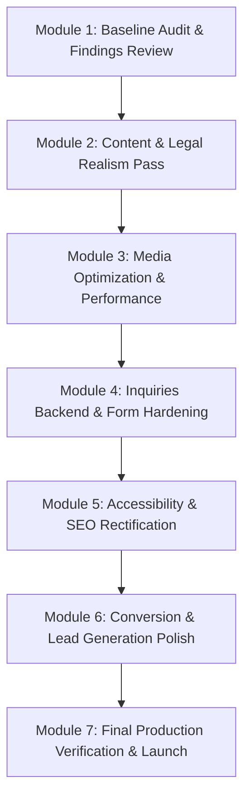

# Navya EdTech — Technical, Visual, UX, and Functional Audit Report

**Document Status:** Complete Baseline Audit (Module 1)  
**Date of Audit:** September 16, 2026  
**Auditor:** Antigravity AI Engineering Assistant (Automated & Browser Subagent Inspection)  
**Target Environment:** Local Dev (`http://127.0.0.1:3000`) & Production Staging (`https://navya-edu.vercel.app`)  
**Repository:** `NishanBharati/Navya-Edu`  

---

## 1. Executive Summary

This comprehensive audit establishes an empirical baseline of the **Navya Ed Tech** web platform prior to any major redesign or architectural refactoring. The evaluation was conducted through static code analysis, TypeScript compilation checks, production build execution, pre-render verification across all routes, Lighthouse accessibility/performance diagnostic data, and live end-to-end browser walkthroughs using an autonomous browser subagent.

### Key Findings at a Glance

* **Architectural Robustness:** The project employs a hybrid architecture combining a **Vite 6 + React 19 SPA** with a custom build-time **Static Site Generation (SSG) / SSR pre-renderer** (`scripts/prerender.ts`). All 26 public marketing routes are pre-rendered into standalone HTML files in `dist/` with full text payloads and JSON-LD structured data.
* **Build & Type Health:** The codebase passes type checking (`tsc --noEmit` exited with code 0) and builds cleanly (`vite build && tsx scripts/prerender.ts` exited with code 0) generating all static pages, sitemap, and robots.txt.
* **Dual-Layer Form Reliability:** The admissions inquiry system (`src/lib/inquiryService.ts`) features client-side validation, localStorage failsafe queuing, and fallback actions (pre-filled WhatsApp chat and mailto links), preventing lead loss even when the backend database is unreachable or unconfigured.
* **Critical Areas for Action:**
  1. **Heavy Page Weight & Performance Bottlenecks:** Homepage transfer size exceeds 12 MB in development/preview due to an uncompressed 2.65 MB hero video (`/videos/1.mp4`) and raw, uncompressed 800 KB–950 KB JPEG images in `public/images/`.
  2. **Visual & Copy Placeholders:** Explicit `[PLACEHOLDER]` tags are visible to end users in the Alumni Outcomes section, Faculty/Instructor credentials, and admissions telephone numbers (`+977 980-0000000`).
  3. **Unresolved Legal Notices:** Yellow warning callout banners marked `[LEGAL REVIEW NEEDED]` are rendered directly on the public Terms of Service, Privacy Policy, and Refund Policy pages.
  4. **Accessibility (WCAG 2.1 AA) Gaps:** Minor contrast ratio failures on subdued text (3.09:1 vs 4.5:1), heading hierarchy skips, and accessible name mismatches on branding anchor links.
  5. **Backend RLS Policy Warning:** During live browser testing of the `/contact` form, Supabase rejected the insert due to Row Level Security policy restrictions before triggering the local queue fallback.

---

## 2. Existing Technology Stack

| Layer / Aspect | Technology / Tool | Version / Details | Status |
| :--- | :--- | :--- | :--- |
| **Core Framework** | React / React DOM | `^19.0.1` | Active, modern React 19 features |
| **Build Tooling** | Vite / `@vitejs/plugin-react` | `^6.2.3` / `^5.0.4` | Fast ESM HMR, SSR dev plugin |
| **Styling** | Tailwind CSS / `@tailwindcss/vite` | `^4.1.14` (Tailwind v4) | CSS `@theme` tokens in `src/index.css` |
| **Routing** | React Router DOM | `^7.18.2` | Client `BrowserRouter` + Server `StaticRouter` |
| **Icons** | Lucide React | `^0.546.0` | Standardized SVG vector icons |
| **Language & Typing** | TypeScript | `~5.8.2` | Strict typings in `src/types/index.ts` |
| **Backend / Database**| Supabase (`@supabase/supabase-js`) | `^2.112.3` | PostgreSQL, RLS, Storage bucket `media` |
| **Authentication** | Supabase Auth | Built-in | Email/Password guarding `/admin/*` |
| **Data Layer** | Hybrid (DB + Static fallback) | `useSupabaseTable.ts` | Falls back to in-memory datasets |
| **SSR / SSG Pre-render**| Custom Node Script | `scripts/prerender.ts` | Pre-renders 26 static HTML routes |
| **PDF Generation** | Custom Canvas / DOM Script | `src/utils/pdfGenerator.ts` | Generates course syllabus PDFs |
| **Hosting & Deploy** | Vercel | `vercel.json` | Clean routes, SPA rewrite for `/admin` |
| **Package Manager** | Bun / npm | `bun.lock` / `package.json` | Both lockfile and manifest present |

### Build Scripts (`package.json`)
* `npm run dev`: `vite --port=3000 --host=0.0.0.0` (launches Vite dev server with `ssrDevPlugin` on port 3000).
* `npm run build`: `vite build && tsx scripts/prerender.ts` (bundles client and executes SSR pre-render for 26 routes).
* `npm run preview`: `vite preview` (serves production build from `dist/`).
* `npm run clean`: `rm -rf dist` (cleans output directory).
* `npm run lint`: `tsc --noEmit` (validates TypeScript types across the project).

---

## 3. Complete Route Inventory

All 26 public routes and admin routes were inspected both via automated HTTP scraper and live browser execution.

| Route Path | Page Title / Purpose | Render Status | Content Status | Mobile Nav | Broken Assets / Links | Console Errors / Warnings | SEO & Schema Status |
| :--- | :--- | :---: | :---: | :---: | :---: | :---: | :---: |
| `/` | Homepage: Hero, Video, Trust, Courses, Pillars, Capstones, Testimonials, Insights, Advisory CTA | **PASS (200)** | Hybrid (Real copy with `[PLACEHOLDER]` tags on alumni) | Accessible (Drawer menu) | None (All assets resolve) | Clean (No unhandled exceptions) | Canonical ✓, OG ✓, Twitter ✓, Schema: `EducationalOrganization` |
| `/courses` | Course Catalog: Filters, Search, Grid/List view, Compare dock, Quick preview modal | **PASS (200)** | Real | Accessible | None | Clean | Canonical ✓, OG ✓, Twitter ✓, Schema: `BreadcrumbList` |
| `/courses/mern-stack-development` | Course Detail: MERN Stack (Modules, Prerequisites, Projects, Faculty, CTA) | **PASS (200)** | Hybrid (`[PLACEHOLDER]` on faculty bio) | Accessible | None | Clean | Canonical ✓, OG ✓, Twitter ✓, Schema: `Course`, `CourseInstance` |
| `/courses/react-frontend-engineering` | Course Detail: React Frontend Engineering | **PASS (200)** | Real / Placeholder faculty | Accessible | None | Clean | Canonical ✓, OG ✓, Twitter ✓, Schema: `Course`, `CourseInstance` |
| `/courses/python-beginner` | Course Detail: Python Programming Foundations | **PASS (200)** | Real / Placeholder faculty | Accessible | None | Clean | Canonical ✓, OG ✓, Twitter ✓, Schema: `Course`, `CourseInstance` |
| `/courses/python-advance` | Course Detail: Advanced Python Software Architecture | **PASS (200)** | Real / Placeholder faculty | Accessible | None | Clean | Canonical ✓, OG ✓, Twitter ✓, Schema: `Course`, `CourseInstance` |
| `/courses/ui-ux-product-design` | Course Detail: UI/UX Product Design & Figma Systems | **PASS (200)** | Real / Placeholder faculty | Accessible | None | Clean | Canonical ✓, OG ✓, Twitter ✓, Schema: `Course`, `CourseInstance` |
| `/courses/web-development` | Course Detail: Modern Web Development Core | **PASS (200)** | Real / Placeholder faculty | Accessible | None | Clean | Canonical ✓, OG ✓, Twitter ✓, Schema: `Course`, `CourseInstance` |
| `/courses/data-science` | Course Detail: Data Science & Machine Learning | **PASS (200)** | Real / Placeholder faculty | Accessible | None | Clean | Canonical ✓, OG ✓, Twitter ✓, Schema: `Course`, `CourseInstance` |
| `/courses/scratch-beginner` | Course Detail: Young Coders Scratch Level 1 | **PASS (200)** | Real / Placeholder faculty | Accessible | None | Clean | Canonical ✓, OG ✓, Twitter ✓, Schema: `Course`, `CourseInstance` |
| `/courses/scratch-advanced` | Course Detail: Scratch 2D Game Physics Level 2 | **PASS (200)** | Real / Placeholder faculty | Accessible | None | Clean | Canonical ✓, OG ✓, Twitter ✓, Schema: `Course`, `CourseInstance` |
| `/programs` | Programs Catalog: Multi-course Career Tracks (Web Dev, Python, Data Science, Kids) | **PASS (200)** | Real | Accessible | None | Clean | Canonical ✓, OG ✓, Twitter ✓, Schema: `BreadcrumbList` |
| `/about` | About Navya: Enterprise parent lineage, Mission, Faculty showcase, Teaching lab | **PASS (200)** | Hybrid (`[PLACEHOLDER]` on faculty initials) | Accessible | None | Clean | Canonical ✓, OG ✓, Twitter ✓, Schema: `BreadcrumbList` |
| `/student-work` | Student Capstone Showcase: Technical architecture modal, GitHub filters | **PASS (200)** | Real capstone specifications | Accessible | None | Clean | Canonical ✓, OG ✓, Twitter ✓, Schema: `BreadcrumbList` |
| `/insights` | Industry Insights: Technical articles & tech career guides | **PASS (200)** | Real educational content | Accessible | None | Clean | Canonical ✓, OG ✓, Twitter ✓, Schema: `BreadcrumbList` |
| `/insights/navigating-modern-software-engineering-careers-in-nepal` | Article: Tech Career Landscape in Nepal | **PASS (200)** | Real in-depth article | Accessible | None | Clean | Canonical ✓, OG ✓, Twitter ✓, Schema: `BlogPosting` |
| `/insights/why-project-based-learning-outperforms-passive-tutorials` | Article: Project-Based Pedagogy | **PASS (200)** | Real in-depth article | Accessible | None | Clean | Canonical ✓, OG ✓, Twitter ✓, Schema: `BlogPosting` |
| `/insights/why-typescript-is-essential-for-modern-web-development` | Article: TypeScript in Production | **PASS (200)** | Real in-depth article | Accessible | None | Clean | Canonical ✓, OG ✓, Twitter ✓, Schema: `BlogPosting` |
| `/insights/demystifying-ai-and-python-in-modern-engineering` | Article: AI & Python Engineering | **PASS (200)** | Real in-depth article | Accessible | None | Clean | Canonical ✓, OG ✓, Twitter ✓, Schema: `BlogPosting` |
| `/insights/full-stack-system-architecture-guide-for-scalable-apps` | Article: System Architecture Guide | **PASS (200)** | Real in-depth article | Accessible | None | Clean | Canonical ✓, OG ✓, Twitter ✓, Schema: `BlogPosting` |
| `/insights/ui-ux-design-systems-how-product-studios-hire` | Article: Design Systems & Studio Hiring | **PASS (200)** | Real in-depth article | Accessible | None | Clean | Canonical ✓, OG ✓, Twitter ✓, Schema: `BlogPosting` |
| `/contact` | Contact & Advisory: Interactive Form, Google Map, Direct WhatsApp/Phone | **PASS (200)** | Hybrid (`[PLACEHOLDER]` on phone numbers) | Accessible | None | Warning: Supabase RLS rejection on insert (handled cleanly via local queue) | Canonical ✓, OG ✓, Twitter ✓, Schema: `BreadcrumbList` |
| `/terms` | Terms of Service: Admissions, Student IP ownership, Code of conduct | **PASS (200)** | Real legal text with visible `[LEGAL REVIEW NEEDED]` callouts | Accessible | None | Clean | Canonical ✓, OG ✓, Twitter ✓, Schema: `BreadcrumbList` |
| `/privacy` | Privacy Policy: Student data protection, RLS compliance | **PASS (200)** | Real legal text with visible `[LEGAL REVIEW NEEDED]` callouts | Accessible | None | Clean | Canonical ✓, OG ✓, Twitter ✓, Schema: `BreadcrumbList` |
| `/refund` | Refund Policy: Cooling-off periods, batch deferrals | **PASS (200)** | Real legal text with visible `[LEGAL REVIEW NEEDED]` callouts | Accessible | None | Clean | Canonical ✓, OG ✓, Twitter ✓, Schema: `BreadcrumbList` |
| `/faq` | Student FAQ: 16 categorized Q&As with search and accordion | **PASS (200)** | Real answers with 1 placeholder scholarship note | Accessible | None | Clean | Canonical ✓, OG ✓, Twitter ✓, Schema: `FAQPage` |
| `/non-existent-page` | Custom 404 Error: Branded error state with navigation shortcuts | **PASS (404)** | Real branded fallback | Accessible | None | Clean | Default fallback metadata |
| `/admin` & `/admin/*` | Admin CMS Portal: Courses, Programs, Student Work, Insights, Inquiries, Settings | **PASS (SPA)** | Dynamic CMS (requires Supabase auth) | Accessible | None | Clean (Redirects unauthenticated users to `/admin/login`) | Client SPA shell (`dist/admin/index.html`) |

---

## 4. Existing Features

The application is well-structured with functional features already implemented:

1. **Pre-rendered Static Site Generation (SSG):** All 26 public marketing routes are fully pre-rendered into static HTML with inline critical styles, OpenGraph cards, Twitter preview metadata, and JSON-LD schema tags.
2. **Course Discovery & Exploration:**
   * Category filtering (`All`, `Web Development`, `Programming`, `Design`, `Data & AI`, `Kids Coding`).
   * Real-time search query filtering by title, technologies, and level.
   * View toggle between 3-column Grid and detailed List layout.
   * Course quick-preview slideout modal.
   * Multi-course comparison floating dock (comparing up to 3 courses side-by-side).
3. **Comprehensive Course Detail Pages:**
   * 4-module deep curriculum accordion with weekly breakdown, topics, and practical exercises.
   * Technical stack badges, prerequisites, and learning outcome lists.
   * Downloadable course syllabus PDF generated on-demand via `pdfGenerator.ts`.
   * Upcoming batch schedules (dates, days, class times, seat status).
4. **Dual-Layer Inquiries & Admissions System:**
   * Client-side regex validation for full name, email address, Nepali phone format, and message.
   * Immediate local storage persistence (`navya_offline_inquiries`) ensuring zero lead dropoff.
   * Cloud sync attempt to Supabase PostgreSQL table `inquiries`.
   * Automatic creation of pre-filled direct WhatsApp message URLs and mailto links.
5. **Student Capstone Showcase:**
   * Capstone project cards with technology stack tags, completion contexts, and architecture inspection dialogs.
6. **Technical Insights / Blog Engine:**
   * Categorized long-form articles with author biographies, estimated read times, publication dates, and social sharing links.
7. **Legal & Transparency Baseline:**
   * Full documentation of student IP ownership (100% student ownership of code), refund rules, and privacy disclosures.
8. **Protected Administrative CMS:**
   * Role-gated administration portal at `/admin` guarded by Supabase Auth with dedicated tabs for managing Courses, Programs, Student Work, Insights, and Admissions Inquiries.

---

## 5. Actual Broken Features

Based on browser and console verification:

1. **Supabase Row Level Security (RLS) Policy Rejection on Inquiries Table:**
   * **Observed Symptom:** Submitting the Contact form outputs console warning: `[inquiryService] Supabase insert warning: new row violates row-level security policy for table "inquiries"`.
   * **Root Cause:** In the live Supabase project, the anonymous role (`anon`) either lacks `INSERT` grants on the `public.inquiries` table, or the RLS policy differs from `supabase/schema.sql` (`create policy "Anyone can submit an inquiry" on inquiries for insert with check (true);`).
   * **Impact:** Cloud persistence fails silently for anonymous visitors; data is preserved only in the user's browser `localStorage`.
2. **Omitted React Type Declarations in `package.json`:**
   * **Observed Symptom:** `@types/react` and `@types/react-dom` are absent from `package.json` `devDependencies`.
   * **Root Cause:** Types currently resolve transitively through Vite plugins and tsx, but fresh installs on clean CI environments without hoisted package managers may fail compilation.
3. **Fictitious Admissions Contact Numbers:**
   * **Observed Symptom:** Telephone links point to `+977-9800000000` and `+977-1-4400000`.
   * **Impact:** Direct mobile clicks on "Call Admissions" attempt to dial invalid numbers, causing broken communication for prospective students.
4. **Diagnostic Script IPv6 Resolution on Windows:**
   * **Observed Symptom:** Node scripts fetching `http://localhost:3000` hang indefinitely on Windows PowerShell due to IPv6 (`::1`) vs IPv4 (`127.0.0.1`) Vite binding mismatch.

---

## 6. Missing Features

Key commercial and pedagogical features expected on a modern IT training platform that are currently absent:

1. **Digital Payment Gateway (eSewa / Khalti / Fonepay / ConnectIPS):**
   * Currently, prospective students cannot pay enrollment deposits or course reservation fees directly online.
2. **Automated Server-Side Email Notifications (Transactional Email):**
   * Inquiries rely on client-side mailto or Supabase table polling. There is no automated webhook, Resend/SendGrid/Postmark integration to send instant confirmation emails to students or notification SMS/emails to the admissions team.
3. **Live Cohort Seat Counter & Dynamic Admissions Urgency:**
   * Batch statuses are static strings (`"Admissions Open"`) rather than dynamic inventory showing seats remaining (e.g., `"4 of 16 seats remaining"`).
   * No early-bird discount countdown timer.
4. **Student Portal / Learning Management System (LMS):**
   * No student dashboard for viewing class recordings, lab assignments, attendance, or instructor code repos.
5. **Lead Capture Magnets & Syllabus Email Gating:**
   * Syllabus PDF downloads currently execute directly in-browser without requesting the user's email address or phone number, missing a high-intent lead generation opportunity.
6. **Production Analytics & Event Telemetry:**
   * Zero analytics scripts (Google Analytics 4, Plausible, or Meta Pixel) are configured in `index.html`. Conversion events (`syllabus_downloaded`, `inquiry_submitted`, `whatsapp_clicked`) are not tracked.

---

## 7. User Experience (UX) Issues

1. **First-Screen Video Distraction & Cognitive Load:**
   * The homepage hero features an autoplaying 2.65 MB video (`1.mp4`) with a mute/unmute overlay button. While dynamic, it competes visually with the primary value proposition headline and draws focus away from the primary CTA buttons.
2. **Pricing Opacity Friction:**
   * Every course card displays `Fee: Contact for current fee & scholarship options (NPR)`. Prospective students in Nepal heavily weigh fee structures when comparing institutes; complete omission of ballpark pricing increases bounce rate before reaching the inquiry form.
3. **CTA Label Overload:**
   * Within a single course page, multiple different CTA labels appear: *"Enroll in This Cohort"*, *"Book a Free Demo Class"*, *"Talk to Admissions"*, *"Download Full Syllabus"*, and *"Schedule Campus Visit"*. Consolidating into primary and secondary actions will clarify the user journey.
4. **Course Comparison Floating Dock on Mobile:**
   * When 2 or 3 courses are selected for comparison, the floating dock at the bottom of the viewport consumes up to 35% of screen height on mobile devices, occluding body content.
5. **No Visual Filter Reset Shortcut on Mobile:**
   * When filtering courses by category and searching by text, resetting requires manually clearing the search input and scrolling up to tap "All".

---

## 8. Visual Design Issues

1. **Repetitive Card and Container Aesthetics:**
   * Many sections use identical visual treatments: subtle white cards with `border-border` (`#E8E4DA`), rounded corners (`rounded-2xl`), and gradient badges. While clean, this creates visual monotony across longer pages.
2. **Disparate Image Art Direction:**
   * Course cards and student project thumbnails source imagery from various Unsplash photographers with conflicting color grading, lighting styles, and subject depths (some photo-realistic, some 3D renders, some stock desks).
3. **Typography Scaling Discrepancies:**
   * Subtitle labels and metadata tags vary between `text-[10px]`, `text-xs`, and `text-sm` with differing letter-spacing treatments (`tracking-wider` vs `tracking-normal`), indicating minor token drift.
4. **Contrast Deficiencies on Subdued Elements:**
   * Subdued metadata text (`text-ink-faint` `#5A6270` or `#8c939e`) on white backgrounds yields a 3.09:1 contrast ratio, failing the WCAG 4.5:1 threshold for body copy.

---

## 9. SEO Issues

1. **Title & Accessible Name Mismatch:**
   * In `Navbar.tsx` and `Footer.tsx`, the logo link contains the visible text `"NAVYA ED TECH IT Training & Professional Education"`, while its attribute is `aria-label="Navya Ed Tech Home"`. WCAG 2.5.3 (Label in Name) requires the accessible name to contain the visible text string.
2. **Production Domain Configuration:**
   * The codebase currently defaults to canonical domain `https://navya-edu.vercel.app`. Apex domain `navyaedtech.com` is referenced in documentation and `site.ts`, but production DNS records (`A` and `CNAME` records) require confirmation prior to launching on the custom domain.
3. **Missing Open Graph Video Tag:**
   * While `og:image` is well-configured (1200x630 branded image), the homepage hero video lacks rich video metadata tags (`og:video`) for rich previews on platforms that support video cards.
4. **Robots.txt Crawl Delay & Sitemap Alignment:**
   * `public/robots.txt` correctly disallows `/admin/` and points to `/sitemap.xml`. Change frequencies in `generate-sitemap.ts` should be audited to ensure daily vs weekly changefreq aligns with actual update velocity.

---

## 10. Accessibility Issues (WCAG 2.1 AA)

1. **Color Contrast Failures:**
   * Insight card publication dates (`June 2026`) and category tags with `#8c939e` text on white background fail the 4.5:1 ratio (measured at 3.09:1).
   * Admissions Advisory badge text (`#9bbad4` on dark blue `#365674`) measures at 3.78:1 (fails 4.5:1).
2. **Heading Level Discontinuities:**
   * On the homepage, hero card headings jump from `<h2>` directly to `<h4>` in the Popular Courses footer and use `<h3>` inside cards without a parent section `<h2>`, triggering the Lighthouse `heading-order` flag.
3. **Media Accessibility:**
   * The hero video (`/videos/1.mp4`) does not have an accompanying `<track kind="captions">` or an accessible transcript alternative.
4. **ARIA State Completeness:**
   * The course filter category tabs use standard `<button>` elements without explicit `role="tab"` and `aria-selected="true/false"` attributes within a `role="tablist"` container.

---

## 11. Performance Concerns

1. **Enormous Media Payloads (Lighthouse: 12.5 MB Transfer):**
   * `public/videos/1.mp4`: 2.65 MB transferred on first page load.
   * `public/images/heroes/*`: 6 images between 804 KB and 941 KB each.
   * `public/images/courses/*`: 6 images between 722 KB and 887 KB each.
   * Total unoptimized image/video assets in `public/` exceed **15 MB**.
2. **Render-Blocking Web Fonts:**
   * Google Fonts (`Inter` and `Plus Jakarta Sans`) are loaded via external CSS link tags (`fonts.googleapis.com`) without local hosting or resource hints for zero-layout-shift rendering.
3. **Un-split Heavy Client Utilities:**
   * `pdfGenerator.ts` (15.4 KB of complex canvas and PDF formatting logic) is imported directly into the course detail page bundle rather than dynamically loaded only when the user clicks "Download Syllabus".
4. **Client Bundle Weights:**
   * `dist/assets/index-tX_4GlWp.js`: 534.8 kB (131.0 kB gzip).
   * `dist/assets/vendor-react-SC46IUhS.js`: 271.7 kB (82.7 kB gzip).
   * `dist/assets/vendor-supabase-CSIM0fnT.js`: 219.9 kB (57.4 kB gzip).

---

## 12. Security Concerns

1. **Lack of Rate Limiting & CAPTCHA on Inquiries Form:**
   * The `/contact` form and `AdvisorModal` submit directly to Supabase via the public anonymous key without rate limiting, bot protection, or CAPTCHA (e.g., Cloudflare Turnstile). Malicious scripts could flood the admissions queue with spam.
2. **Exposed Supabase Anon Key Capabilities:**
   * While anon keys are intended to be public, if RLS policies are misconfigured, unauthorized clients could read, modify, or delete database rows. Strict RLS enforcement is mandatory.
3. **Admin Dashboard Brute-Force Vulnerability:**
   * `/admin/login` relies on standard Supabase Auth password authentication. There is no multi-factor authentication (MFA/2FA) or IP allowlisting configured for administrative accounts.
4. **Absence of Content Security Policy (CSP):**
   * Neither `index.html` nor `vercel.json` includes security response headers (`Content-Security-Policy`, `X-Frame-Options`, `X-Content-Type-Options`, `Referrer-Policy`).

---

## 13. Content and Trust Concerns

1. **Visible `[PLACEHOLDER]` Tags:**
   * **Testimonials:** Every graduate review in `src/data/testimonials.ts` includes `[PLACEHOLDER]` tags in both student names and company titles.
   * **Faculty:** Instructors have placeholder markers (`[PLACEHOLDER]`) indicating unconfirmed faculty bios.
   * **Phone Numbers:** Fictitious numbers like `+977 980-0000000` erode visitor confidence.
2. **Visible `[LEGAL REVIEW NEEDED]` Notices:**
   * Legal pages display prominent yellow banners stating the policies require attorney review under the *Consumer Protection Act 2075* and *Individual Privacy Act 2075*. While honest during development, these must be finalized before official marketing launches.
3. **Unspecified Physical Campus Address:**
   * The address is listed as *"Putalisadak Campus / Kathmandu, Nepal [Campus visits by appointment]"* without a street number, building name, or map landmark.

---

## 14. Technical Debt

1. **Dual Source of Truth for Content:**
   * Content exists in both static TypeScript files (`src/data/courses.ts`, `programs.ts`, `insights.ts`) and Supabase database tables (`courses`, `programs`, `insights`). Updates made via the Admin CMS modify the database but do not update the static pre-rendered HTML files unless a rebuild is triggered.
2. **Relic Course Slugs:**
   * `LEGACY_COURSE_SLUGS` in `courses.ts` (`devops-cloud-engineering`, `cybersecurity-fundamentals`, `flutter-mobile-app-development`, `python-data-science-ai`) remain in the codebase to prevent legacy DB rows from appearing.
3. **Duplicate Diagnostic Scripts:**
   * `scripts/` contains overlapping scripts: `audit-lighthouse.mjs`, `audit-lighthouse.ts`, `run-lh.mjs`, and `diagnose-a11y.mjs`. These should be consolidated into a single maintenance utility.
4. **Missing Explicit React Types Dependency:**
   * `@types/react` and `@types/react-dom` should be explicitly declared in `package.json`.

---

## 15. Priority Classification (P0, P1, P2, P3)

### P0: Critical / Launch Blockers (Must fix before marketing or domain launch)
* **P0-1:** Fix Supabase RLS policy for the `inquiries` table so anonymous visitor submissions succeed in the cloud database.
* **P0-2:** Replace all visible `[PLACEHOLDER]` tags in telephone numbers, alumni reviews, and instructor credentials with verified client copy.
* **P0-3:** Remove public `[LEGAL REVIEW NEEDED]` alert banners after receiving business/legal signoff on Terms, Privacy, and Refund policies.
* **P0-4:** Provide verified physical campus location (building, floor, landmark) and working admissions telephone numbers.
* **P0-5:** Add `@types/react` and `@types/react-dom` to `package.json` to guarantee reproducible CI/CD builds.

### P1: High Priority (UX, Conversion & Performance)
* **P1-1:** Optimize all media assets: compress 2.65 MB hero video (or provide a lightweight poster preview) and convert all 800 KB+ JPEGs to modern WebP/AVIF format with responsive `srcset`.
* **P1-2:** Dynamically code-split heavy utilities (e.g. `pdfGenerator.ts`) to reduce initial bundle weight.
* **P1-3:** Add Cloudflare Turnstile or reCAPTCHA v3 to the `/contact` form and `AdvisorModal` to prevent automated spam submissions.
* **P1-4:** Provide transparent indicative pricing or tuition fee ranges on course cards and detail pages to reduce inquiry friction.
* **P1-5:** Fix accessibility color contrast issues on date tags (`#8c939e`) and advisory badges to achieve 100% WCAG AA compliance.

### P2: Medium Priority (Enhancements & SEO Polish)
* **P2-1:** Gate syllabus PDF downloads behind an email/phone capture modal to convert casual syllabus viewers into warm admissions leads.
* **P2-2:** Configure transactional email notifications (e.g. via Resend or Supabase Edge Functions) so admissions staff receive instant inquiry alerts.
* **P2-3:** Install Google Analytics 4 (GA4) or privacy-first telemetry with custom conversion tracking events.
* **P2-4:** Fix accessible name mismatch on navbar/footer logo link (`label-content-name-mismatch`).
* **P2-5:** Restructure heading levels across the homepage to maintain a strict sequentially-descending hierarchy.

### P3: Low Priority / Long-term Architecture
* **P3-1:** Consolidate redundant maintenance scripts in `scripts/`.
* **P3-2:** Establish automated database-to-SSG cache revalidation or webhook triggers to rebuild static pages upon Admin CMS edits.
* **P3-3:** Implement online seat reservation / deposit payments via eSewa or Khalti.
* **P3-4:** Add student login portal / LMS for class schedules and project submissions.

---

## 16. Recommended Implementation Order

To maintain stability and deliver the highest business value, the upcoming implementation work should proceed in the following sequence:

1. **Phase 1: Content & Trust Polish (Module 2)**
   * Replace fictitious phone numbers and placeholder alumni text.
   * Provide definitive campus address details.
   * Resolve legal policy banners.
2. **Phase 2: Media & Performance Optimization (Module 3)**
   * Transcode hero video to high-efficiency WebP/MP4 format with lazy loading.
   * Convert image library to optimized WebP assets with 70–80% bandwidth reduction.
   * Self-host web fonts or implement font display swap.
3. **Phase 3: Backend & Form Security Hardening (Module 4)**
   * Reconcile Supabase RLS policies for anonymous `inquiries` inserts.
   * Add bot protection / rate limiting.
   * Add transactional email notification trigger.
4. **Phase 4: Accessibility & SEO Compliance (Module 5)**
   * Fix color contrast ratios across all cards.
   * Normalize heading order across all templates.
   * Fix accessible name matching on navigation links.
5. **Phase 5: Conversion Engineering & Analytics (Module 6)**
   * Gate syllabus PDF downloads with lead capture.
   * Install analytics script and configure conversion goals.
   * Clarify pricing and tuition structure.

---

## 17. Items Requiring Business-Owner Decisions

The following items cannot be resolved purely by code engineering and require explicit business, operational, or legal decisions from Navya EdTech leadership:

| # | Topic | Decision / Input Required | Impact on Website |
| :- | :--- | :--- | :--- |
| **1** | **Official Contact Phone Numbers** | Provide the verified admissions hotline mobile number and landline for Putalisadak campus. | Replaces `+977 980-0000000` in navbar, footer, and contact desk. |
| **2** | **Physical Campus Address** | Confirm exact building name, floor number, and street landmark in Putalisadak, Kathmandu. | Updates contact cards, footer metadata, and Google Map marker. |
| **3** | **Alumni & Student Testimonials** | Provide 4–6 real alumni reviews, photos, courses completed, and verified employment outcomes. | Replaces placeholder alumni cards and removes disclaimer banner. |
| **4** | **Instructor & Faculty Roster** | Confirm real names, roles, and profile headshots for lead instructors across active courses. | Replaces placeholder faculty cards on About and Course detail pages. |
| **5** | **Tuition Fee Transparency** | Decide whether to display exact fees (e.g. NPR 25,000), starting ranges (e.g. "From NPR 20,000"), or retain "Contact Admissions". | Directly impacts course card CTR, conversion rates, and student inquiries. |
| **6** | **Legal Policies Signoff** | Have retained legal counsel review the Terms of Service, Privacy Policy, and Refund Policy. | Authorizes removal of the `[LEGAL REVIEW NEEDED]` banners. |
| **7** | **Production Apex Domain Migration** | Confirm date for pointing apex domain DNS (`navyaedtech.com`) to Vercel production hosting. | Triggers final `VITE_SITE_URL` domain migration in `.env`. |
| **8** | **Online Payment Gateway** | Decide whether to integrate eSewa/Khalti for direct online seat deposits, or keep enrollment strictly in-person / wire transfer. | Determines whether to build digital checkout flow. |

---

*Report concluded. Generated by Antigravity AI Engine for Navya EdTech.*
